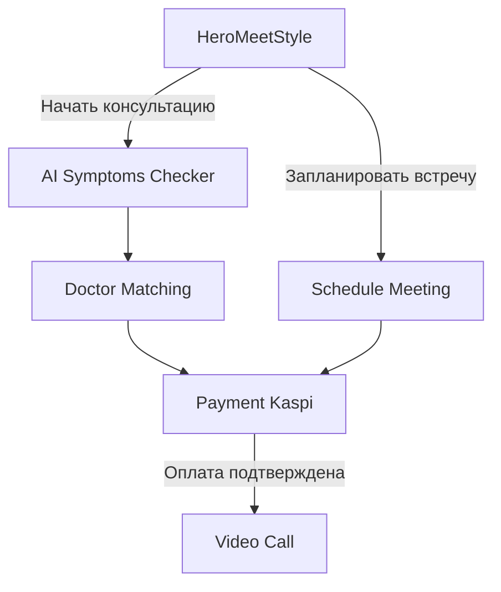

# 🏥 Система Быстрой Консультации (Google Meet Style)

## 📋 Обзор

Новая система консультаций вдохновлена Google Meet и предоставляет полный цикл от описания симптомов до видео-консультации.

## 🎯 Компоненты Системы

### 1. **HeroMeetStyle** - Главная страница
**Файл:** `/src/sections/HeroMeetStyle.tsx`

**Особенности:**
- Современный дизайн в стиле Google Meet
- 2 основные кнопки:
  - **"Начать консультацию"** → Мгновенная консультация через ИИ
  - **"Запланировать встречу"** → Выбор времени и врача
- Анимированный фон с градиентами
- Карточки с преимуществами (Быстро, Умный подбор, Безопасно)
- Индикаторы доверия (500+ консультаций, рейтинг 4.9/5)

**Использование:**
```tsx
import HeroMeetStyle from "@/sections/HeroMeetStyle";

// В вашей главной странице
<HeroMeetStyle />
```

---

### 2. **AI Symptoms Checker** - Страница описания симптомов
**Файл:** `/src/app/consultation/symptoms/page.tsx`
**URL:** `/consultation/symptoms`

**Особенности:**
- Чат с ИИ ассистентом
- Интерактивный диалог для сбора информации о симптомах
- Голосовой ввод (кнопка микрофона)
- Автоматический переход к подбору врача после 4-х обменов сообщениями
- Плавные анимации сообщений

**Процесс:**
1. Пациент описывает симптомы
2. ИИ задает уточняющие вопросы
3. После сбора информации → переход на `/consultation/matching`

---

### 3. **Doctor Matching** - Подбор врача
**Файл:** `/src/app/consultation/matching/page.tsx`
**URL:** `/consultation/matching`

**Особенности:**
- ИИ анализ симптомов (3 секунды анимации)
- Карточка с подходящим врачом:
  - Имя, специальность, рейтинг
  - Опыт работы и образование
  - Клиника и языки
  - Время доступности ("Доступен через 5 минут")
- Стоимость консультации: 15,000 ₸
- Длительность: 30 минут

**Процесс:**
1. Показывается анимация подбора врача
2. Отображается карточка с идеальным специалистом
3. Кнопка "Перейти к оплате" → `/consultation/payment`

---

### 4. **Payment Page** - Оплата через Kaspi
**Файл:** `/src/app/consultation/payment/page.tsx`
**URL:** `/consultation/payment`

**Особенности:**
- Оплата через Kaspi перевод
- Таймер обратного отсчета (10 минут)
- Инструкция по оплате (5 шагов)
- Кнопка копирования номера телефона врача
- ID консультации для отслеживания
- Статусы:
  - **pending** - ожидание оплаты
  - **waiting** - ожидание подтверждения врача
  - **confirmed** - оплата подтверждена
  - **failed** - время истекло

**Процесс:**
1. Отображается номер Kaspi врача и сумма
2. Пациент переводит деньги
3. Нажимает "Я оплатил"
4. Врач получает уведомление (симуляция - 5 секунд)
5. После подтверждения → автоматический переход в видео-колл

---

### 5. **Schedule Meeting** - Планирование встречи
**Файл:** `/src/app/consultation/schedule/page.tsx`
**URL:** `/consultation/schedule`

**Особенности:**
- Выбор врача из списка (с рейтингом)
- Календарь на 7 дней вперед
- Временные слоты (09:00 - 19:00)
- Поле для описания симптомов
- Итоговая сводка выбранной консультации
- Стоимость: 15,000 ₸

**Процесс:**
1. Пациент описывает симптомы
2. Выбирает врача
3. Выбирает дату и время
4. Подтверждает → переход на оплату

---

## 🎨 Дизайн-система

### Цвета
- **Основной градиент:** `from-blue-600 to-indigo-600`
- **Фон:** `from-white via-blue-50 to-indigo-50`
- **Успех:** `green-500`, `green-600`
- **Ошибка:** `red-500`, `red-600`
- **Предупреждение:** `yellow-500`, `yellow-600`

### Анимации
- **Framer Motion** для плавных переходов
- **Пульсация** для индикаторов загрузки
- **Hover эффекты** с `scale-105`
- **Появление элементов** с `opacity` и `y` transitions

---

## 🔄 Полный Flow Консультации



### Мгновенная консультация:
1. **Hero** → Нажать "Начать консультацию"
2. **Symptoms** → Описать симптомы ИИ (4 вопроса)
3. **Matching** → ИИ подбирает врача (3 сек)
4. **Payment** → Оплата через Kaspi (10 мин таймер)
5. **Video Call** → Автоматический переход после подтверждения

### Запланированная консультация:
1. **Hero** → Нажать "Запланировать встречу"
2. **Schedule** → Выбрать врача, дату, время
3. **Payment** → Оплата через Kaspi
4. **Video Call** → В назначенное время

---

## 🚀 Интеграция с существующей системой

### Использование нового Hero:
```tsx
// В файле app/page.tsx или любой главной странице
import HeroMeetStyle from "@/sections/HeroMeetStyle";

export default function Home() {
  return (
    <main>
      <HeroMeetStyle />
      {/* Остальной контент */}
    </main>
  );
}
```

### Настройка маршрутов:
Все новые страницы уже созданы в правильной структуре:
- ✅ `/consultation/symptoms`
- ✅ `/consultation/matching`
- ✅ `/consultation/payment`
- ✅ `/consultation/schedule`

---

## 📱 Адаптивность

Все компоненты полностью адаптивны:
- **Mobile-first** подход
- Breakpoints: `sm:`, `md:`, `lg:`
- Responsive grid layouts
- Touch-friendly кнопки

---

## 🔧 Требуемые пакеты

Все необходимые пакеты уже установлены:
- ✅ `framer-motion` - анимации
- ✅ `@fortawesome/react-fontawesome` - иконки
- ✅ `react-toastify` - уведомления
- ✅ `next/navigation` - роутинг

---

## 💡 Следующие шаги

### Backend интеграция:
1. **AI Symptoms API** - реальный анализ симптомов
2. **Doctor Matching API** - умный подбор врача
3. **Payment Gateway** - интеграция с Kaspi API
4. **WebSocket** - real-time уведомления врачам
5. **Video Call API** - интеграция с Jitsi/WebRTC

### Улучшения:
1. Добавить историю консультаций
2. Чат с врачом до видео-звонка
3. Напоминания о запланированных консультациях
4. Система отзывов после консультации
5. Медицинская карта пациента

---

## 📞 Поддержка

Если возникнут вопросы по новой системе, обращайтесь к документации или команде разработки.

**Создано:** 2026-01-07
**Версия:** 1.0.0
**Статус:** ✅ Готово к использованию
